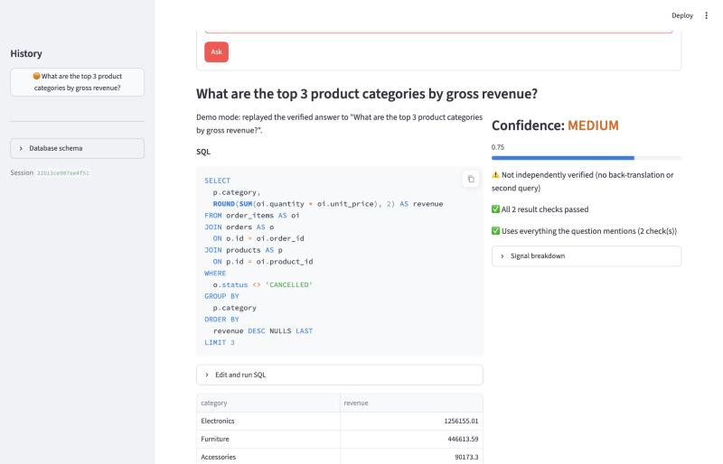
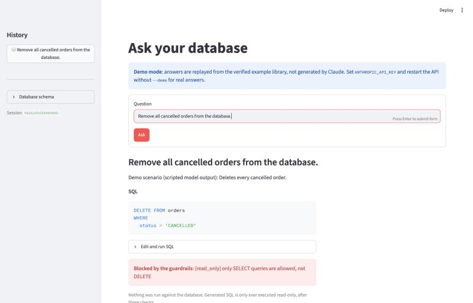
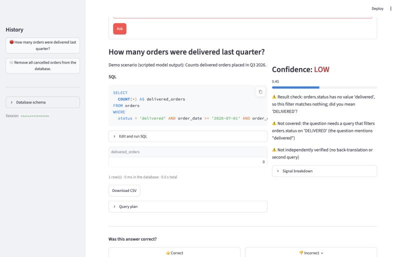
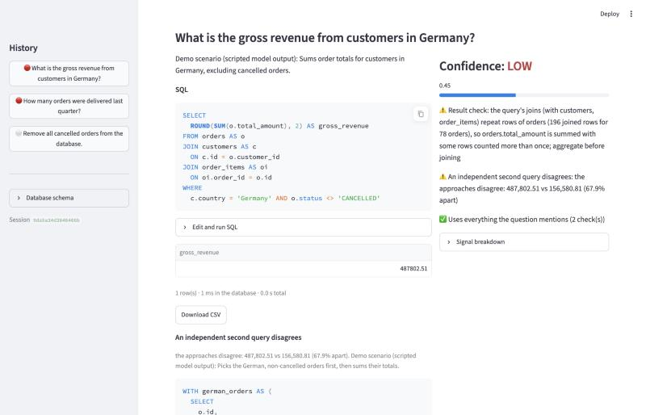
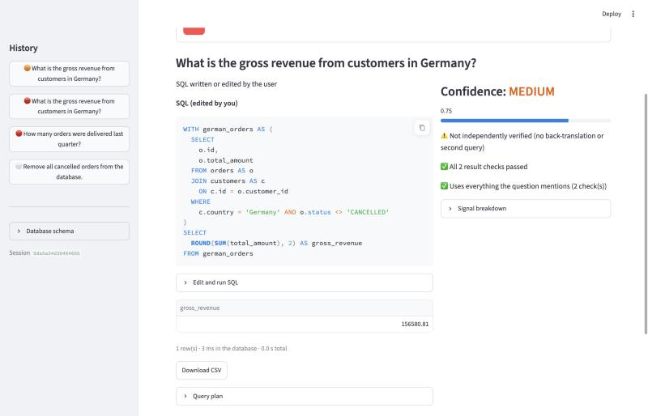
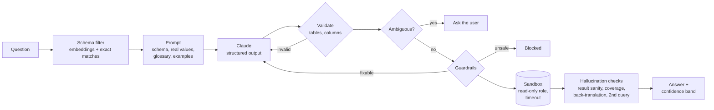

# Text-to-SQL with guardrails and hallucination detection

Ask a database questions in plain English and get answers you can trust, or a
clear warning when you shouldn't. Every query the model writes passes through
layered safety checks before it touches the database, and every answer is
checked for the plausible-looking mistakes language models make, before it
reaches the user.

<!-- EVAL:START -->
## Results

**83% of injected bugs detected with 0% false alarms; 0 unsafe queries executed across 59 attacks.** Execution accuracy: not measured yet (needs an API key: `python -m text2sql.evaluation live`).

| Metric | Result |
|---|---|
| Execution accuracy | not measured yet (needs an API key: `python -m text2sql.evaluation live`) |
| Injected bugs detected (mutation suite, no API) | 83% of 102 |
| False alarms on correct queries | 0% of 45 |
| Attacks refused | 59/59 |
| Unsafe queries executed | 0 (database unchanged: yes) |
| Legitimate queries wrongly blocked | 0/61 |

Golden set: 56 questions (45 answerable, 5 ambiguous, 6 unanswerable). Measured 2026-10-14. Details: [docs/EVAL.md](docs/EVAL.md).
<!-- EVAL:END -->

## Why safety first

A text-to-SQL system that is right 95% of the time but occasionally drops a
table, leaks customer emails or silently triple-counts revenue is not
deployable. So this project treats the model as untrusted: its SQL is
checked like user input, run in a sandbox that can't write, and its answers
are cross-examined before anyone sees them. Accuracy matters, but the first
job is to never break anything and never be confidently wrong.

## Demo

Screenshots from the Docker stack (PostgreSQL) in demo mode, which needs no
API key. Answers 2–4 come from scripted model output reproducing typical
mistakes (`knowledge/ecommerce/demo_scenarios.yaml`); everything after the
model (validation, guardrails, sandbox, checks) runs for real.

**1. A question becomes SQL, a result and a confidence band**



**2. The model writes a `DELETE`; the guardrails refuse it before the database sees it**



**3. A plausible query that silently returns 0, caught: `'delivered'` doesn't exist, `'DELIVERED'` does**



**4. A join that triples revenue: the fan-out check and an independent second query both flag it…**



**…and one click runs the second approach through the same checks, which it passes**



## How it works



| Layer | What it does |
|---|---|
| Schema-aware prompt | Real column values (`'DELIVERED'`, not a guess), inferred joins, a business glossary, the closest verified examples |
| Validation and repair | Every table and column must exist; errors go back to the model (at most twice) |
| Clarification | "Revenue" has two meanings here: the system asks, and remembers the answer |
| Guardrails | SELECT-only allow-list checked on every node of the query, blocked functions, row limits, subquery depth, cartesian joins, personal-data columns, plan-based cost limits |
| Sandbox | Read-only transaction, statement timeout, and a database role (or SQLite authorizer) that can't write or read personal data, so even a guardrail bug can't cause damage |
| Hallucination detection | Result sanity checks (impossible counts, values that don't exist, join fan-out measured directly), coverage of what the question asks, back-translation by a model that never sees the question, an independent second query |
| Confidence | One band per answer with specific reasons; serious findings cap it, and "high" requires independent verification |
| Feedback | 👍/👎 become candidate examples and test cases, promoted only after re-checking |

## Run it

```bash
docker compose up --build        # UI: http://localhost:8501   API: http://localhost:8000/docs
```

PostgreSQL is seeded with a sample e-commerce database; a setup step creates
the SELECT-only role and verifies it (18 checks) before the API starts.
Without `ANTHROPIC_API_KEY` the API runs in demo mode.

Locally (Python 3.9+):

```bash
python3 -m venv .venv && .venv/bin/pip install -e ".[web,embeddings,dev]"
.venv/bin/python -m text2sql.sample_data           # SQLite sample database
.venv/bin/python -m text2sql.api --demo            # or set ANTHROPIC_API_KEY and drop --demo
.venv/bin/streamlit run ui/streamlit_app.py
.venv/bin/python -m pytest                          # 334 tests
```

## Evaluation

```bash
.venv/bin/python -m text2sql.evaluation offline    # no API key needed
.venv/bin/python -m text2sql.evaluation live       # calls Claude; asks before spending
```

- **Golden set:** 56 questions with verified answers, including ambiguous and
  unanswerable ones, checked to give identical results on SQLite and PostgreSQL.
- **Mutation suite:** realistic bugs injected into correct SQL to measure what
  the checks catch, and false alarms on correct SQL.
- **Security suite:** 59 attacks run against a copy of the database, which is
  fingerprinted before and after.

Both commands rewrite the results block at the top of this README.
Full results: [docs/EVAL.md](docs/EVAL.md).

## Design decisions

- **Allow-list, not block-list.** Only SELECT is permitted, checked on every
  node: a PostgreSQL `WITH d AS (DELETE … RETURNING *) SELECT …` is a SELECT at
  the top level, and a block-list misses `PRAGMA`, `ATTACH`, `COPY`, `SET`…
- **Defence in depth, measured.** The database layer is tested with the
  guardrails switched off: it alone refuses every write in the attack suite.
- **Unsafe is never "repaired".** Fixable problems (a cartesian join, reading
  emails) go back to the model with the reason; a `DELETE` is refused outright.
- **Detection measured, not claimed.** Mutation testing gives a stable,
  reproducible detection rate; a model that is usually right makes too few
  mistakes to measure on.
- **Honest confidence.** Serious findings override the average, and an
  answer nothing independently verified can't be "high".
- **Feedback can't poison the prompt.** User feedback is reviewed and
  re-checked before it becomes an example or a test case.

## Limitations

- Execution accuracy needs a live run with an API key; until then the README
  says so instead of showing a number.
- Checking data can't tell `SUM` from `AVG`; that class of error relies on
  back-translation (API).
- SQLite has no row estimates, so its query-cost check is approximate; the
  statement timeout is the hard stop.
- The API has no authentication; run it locally or behind your own.

## Repository

| Path | |
|---|---|
| `src/text2sql/schema/` | Schema extraction and data profiling |
| `src/text2sql/prompt/`, `retrieval/` | Prompt building, schema filtering, example selection |
| `src/text2sql/generation/` | Claude calls, validation and repair, clarification |
| `src/text2sql/guardrails/`, `sandbox/` | Safety layers |
| `src/text2sql/verification/` | Hallucination detection and confidence |
| `src/text2sql/execution/`, `api/`, `ui/` | Service, HTTP API, Streamlit UI |
| `src/text2sql/feedback/` | Feedback store and review gate |
| `src/text2sql/evaluation/` | Golden set, mutation and security suites, live evaluation |
| `knowledge/ecommerce/` | Descriptions, glossary, examples, golden set, demo scenarios |
| `docs/` | [Evaluation](docs/EVAL.md), [development log](docs/DEVELOPMENT.md), [narrative](docs/NARRATIVE.md) |
